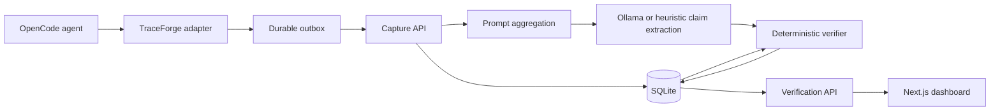

# TraceForge

TraceForge verifies what a coding agent says it completed. It captures OpenCode execution events, extracts atomic claims from the final response, checks those claims against prompt-scoped evidence, and presents the verdicts in a web dashboard.

TraceForge is designed for reproducible research and practical auditing. A local Ollama model extracts claims, but deterministic rules assign verdicts. The model cannot mark its own claims as verified.

## What TraceForge verifies

| Verdict        | Meaning                                                                        |
| -------------- | ------------------------------------------------------------------------------ |
| `VERIFIED`     | Required evidence matches the claim.                                           |
| `CONTRADICTED` | Captured evidence directly conflicts with the claim.                           |
| `UNSUPPORTED`  | The claim is checkable, but matching or complete evidence is missing or stale. |
| `UNVERIFIABLE` | No deterministic rule can establish the claim.                                 |

The reliable first-paper scope is file creation/modification, command completion, build results, and test results. A changed file hash proves that a file changed; it does not prove semantic claims such as “the bug is fixed.” Those claims require an independent acceptance test and otherwise remain `UNVERIFIABLE`.

## System flow



1. The OpenCode adapter captures the prompt, final assistant response, file state, commands, builds, and tests.
2. A disk-backed outbox retries delivery when the API is unavailable.
3. The API stores an ordered, hash-linked trace for each prompt.
4. The extractor converts only the final response into atomic claims. Ollama output is schema-validated and must quote the source response.
5. Deterministic rules select prompt-scoped evidence, check exact results and evidence freshness, and assign verdicts.
6. The dashboard shows daily summaries, individual queries, claims, verdict explanations, and evidence events.

## Technology

- Node.js and TypeScript
- OpenCode plugin hooks
- SQLite using `node:sqlite`
- Ollama through its loopback HTTP API
- Next.js and React
- Vitest

## Repository structure

| Path                                | Responsibility                                                   |
| ----------------------------------- | ---------------------------------------------------------------- |
| `packages/adapter-opencode/`        | OpenCode hooks, event normalization, durable delivery            |
| `src/server.ts`                     | Capture and read-only verification HTTP API                      |
| `src/prompt-store.ts`               | Prompt lifecycle, final-response selection, capture files        |
| `src/modules/verification/`         | Claim extraction, evidence policies, verdict rules, repositories |
| `packages/verification-contracts/`  | Runtime-validated API contracts shared with the web app          |
| `apps/web/`                         | Verification dashboard                                           |
| `infrastructure/sqlite-migrations/` | Versioned SQLite schema                                          |
| `research/`                         | Labeled-dataset format and evaluation instructions               |
| `opencode-activity-captures/`       | Human-readable capture bundles generated at runtime              |

Dependencies point inward: presentation and adapters call application services; application services depend on domain contracts and repository ports; infrastructure implements those ports.

## Requirements

- Node.js 22.22.2 or newer
- npm 11 or newer
- OpenCode for live capture
- Ollama with a local extraction model when model-based extraction is enabled

## Install

```powershell
git clone <repository-url>
cd traceforge
npm install
Copy-Item .env.example .env
Copy-Item apps/web/.env.example apps/web/.env.local
npm run key:generate
```

Put the generated encryption key in `.env`. Set the same `TRACEFORGE_API_TOKEN` in `.env` and `apps/web/.env.local`. Never commit either file.

For local model extraction, install Ollama and a local model. Configure:

```env
TRACEFORGE_EXTRACTOR=ollama
TRACEFORGE_LLM_ENDPOINT=http://127.0.0.1:11434/api/chat
TRACEFORGE_LLM_MODEL=qwen3.5:4b
TRACEFORGE_LLM_TIMEOUT_MS=180000
```

The extractor is restricted to a loopback Ollama endpoint. The adapter and browser never access the model service.

## Start TraceForge

Run the API and dashboard in separate terminals from the repository root.

```powershell
npm run api:up
```

```powershell
npm run web:dev
```

Open `http://localhost:3000`. Check API health at `http://127.0.0.1:8080/healthz` and web health at `http://localhost:3000/api/health`.

## Connect an OpenCode project

Build the adapter with `npm run build`, then add its absolute file URL to the target project's `opencode.json`:

```json
{
  "$schema": "https://opencode.ai/config.json",
  "plugin": [
    "file:///E:/absolute/path/traceforge/packages/adapter-opencode/dist/operational-plugin.js"
  ]
}
```

Use forward slashes and encode spaces as `%20`. If the adapter cannot discover TraceForge's `.env`, set it before starting OpenCode:

```powershell
$env:TRACEFORGE_RUNTIME_ENV = "E:\absolute\path\traceforge\.env"
opencode
```

Restart an existing OpenCode process after rebuilding the adapter.

## Data and security

The default database is `data/traceforge.sqlite`. Generated source snapshots are encrypted with AES-256-GCM. Sensitive paths such as `.env`, `.git`, and `node_modules` are excluded from source capture. Large, binary, invalid UTF-8, and out-of-workspace files are also excluded.

Every trace event stores its predecessor hash and its own hash. This detects later modification of the stored sequence; it does not prove that the original runtime observation was truthful. State that trust boundary in research reporting.

## Research evaluation

The example dataset is synthetic and only checks the evaluation pipeline:

```powershell
npm run research:export -- research/annotation-natural.jsonl
```

```powershell
npm run research:evaluate -- research/evaluation.example.jsonl heuristic
```

After preparing an independently labeled dataset and starting Ollama:

```powershell
npm run research:evaluate -- research/your-labelled-dataset.jsonl ollama
```

The report includes extraction precision, recall, F1, verdict accuracy, and a confusion matrix. See [research/README.md](research/README.md) for the dataset protocol. Do not report results from `evaluation.example.jsonl` as an experiment.

## Quality commands

| Command                 | Purpose                                  |
| ----------------------- | ---------------------------------------- |
| `npm run build`         | Build the backend and OpenCode adapter   |
| `npm run build:all`     | Build backend, adapter, and dashboard    |
| `npm run typecheck:all` | Type-check all workspaces                |
| `npm test`              | Run backend, adapter, and contract tests |
| `npm run web:test`      | Run dashboard tests                      |
| `npm run quality:all`   | Run the complete quality suite           |
| `npm run web:test:e2e`  | Run dashboard HTTP end-to-end tests      |

## Current limitations

- Local extraction speed and quality depend on the selected model and available hardware.
- Semantic implementation claims require an independent acceptance oracle.
- Shell commands are captured, but file-state evidence is strongest when OpenCode uses recognized file-writing tools.
- Test counts depend on supported output formats; unsupported formats produce incomplete evidence rather than guessed values.
- The included research dataset is a format example, not a publication dataset.

## License and citation

Add the chosen open-source license before public release. Add the paper citation and archival dataset DOI after acceptance or preprint publication.
